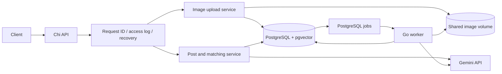

# image-relevance architecture

**Description:** AI Image Understanding & Content Matching Engine<br>
**Origin:** FlyRank Backend AI Engineering Capstone

The current implementation is a Go modular monolith with separate API and worker processes, PostgreSQL/pgvector persistence, and one Gemini provider adapter. Development business routes use the seeded development tenant; tenant authentication is not yet implemented.



## Implemented request and processing paths

1. `POST /v1/images` validates JPEG/PNG bytes, size and dimensions; calculates SHA-256; stores the bytes by content hash; creates an image row and `analyze_image` job in PostgreSQL.
2. The worker claims jobs with `SELECT ... FOR UPDATE SKIP LOCKED`, commits the claim before provider requests, and limits concurrency. It records provider usage, validates structured metadata and embedding dimensions, then persists results and job/image states transactionally.
3. `POST /v1/posts` asks Gemini to resolve the article subject and embed the article text using the same embedding model/dimensions as the original image content.
4. `POST /v1/posts/{postID}/matches` retrieves nearest direct-image vectors with cosine distance. A phrase-aware subject-key guard, image uncertainty, article subject confidence, and similarity threshold determine eligibility. Rejected candidates carry a reason. The service returns `no_confident_match` instead of forcing a result.
5. `POST /v1/matches/{suggestionID}/review` appends a review action. It does not alter the stored AI suggestion.

The business routes are registered only for `APP_ENV=development`. The production environment still lacks tenant authentication and must not expose these routes.

## Runtime processes

- `cmd/api` loads configuration, opens a pgx pool, applies embedded migrations, and serves HTTP with request IDs, structured logs, recovery, bounded request timeouts, and graceful shutdown.
- `cmd/seed` idempotently creates the development tenant and refuses other environments.
- `cmd/worker` requires `GEMINI_API_KEY`, applies migrations, and runs the PostgreSQL-backed queue. It is behind Compose's `ai` profile so the API/database foundation can run without provider credentials.
- `cmd/evaluate` validates licensed image and article CSV manifests, checks the image rows in PostgreSQL, executes actual matching, and prints calculated metrics.

## Final capstone demonstration

The curated Commons dataset has 40 visually reviewed images across four species categories. Evaluation categories come from the reviewed manifest; the model's broader `image_analysis.category` values (such as `mammal` or `bird`) are not treated as fine-grained species labels. Ten source-derived animal posts have category-level positive labels, and an unrelated geology post is the no-suitable control. `scripts/bootstrap-evaluation.py` regenerates ignored runtime UUID manifests for the current database from stable filenames and source keys.

The 2026-11-12 fresh isolated-database evaluation returned 10/10 correct top-1 matches across the ten relevant posts, top-1 precision `1.0`, 10/11 recommendation coverage, accepted-recommendation precision `1.0`, zero incorrect accepted matches, and one abstention. The image/category labels have a single visual reviewer and no independent adjudication, so these scores are demonstration evidence rather than a general quality claim.

Provider usage records are written for classification, subject resolution, and embedding requests. Records include provider/model/operation, outcome, latency, available token counts, and a cost basis. Costs are list-price estimates only when a verified rate and usage data are available; text-embedding responses in the fresh run supplied no token counts, so those rows have no estimate. See `EVIDENCE.md` for observed counts and totals.

## Data and package layout

```text
cmd/api/                    HTTP process wiring
cmd/seed/                   development tenant seed command
cmd/worker/                 background worker process
cmd/evaluate/               labeled evaluation CLI
scripts/download-curated-dataset.py Commons image download with SHA-256 verification
scripts/bootstrap-evaluation.py        corpus importer and runtime UUID manifest generator
internal/config/            environment parsing and safe defaults
internal/database/          pgx pool and embedded migrations
internal/database/migrations/ SQL migrations embedded in API and worker
internal/domain/            image metadata validation and subject keys
internal/evaluation/        licensed manifest validation and metrics
internal/httpapi/           operational, image, post, match, review routes
internal/ingestion/         image validation, storage, deduplication, job creation
internal/matching/          post creation, vector retrieval, mismatch guard, review
internal/middleware/        request ID, access logging, panic recovery
internal/providers/gemini/  Google GenAI client adapter and usage metadata
internal/worker/            queue claiming, retries, persistence, usage capture
```

Postgres migration files live at `internal/database/migrations/`. Image bytes use a separate persistent Docker volume shared by API and worker. The existing local `flyrank` database/user and `postgres_data` volume are retained; changing Compose project/database identity requires an explicit data migration.

Raw-image vectors are stored separately in `image_embeddings`; article-text vectors are stored on `posts`. Vision-generated caption text is stored in `image_analysis.caption` and is not used as a substitute for the direct-image vector.

## Migrations and cancellation

`database.Migrate` uses its context while pinging PostgreSQL. The current `golang-migrate` `m.Up()` API has no context parameter, so cancellation cannot interrupt a migration once `m.Up()` starts. Keep startup migrations short; before long-running changes, use database lock/statement timeouts or a separate migration procedure. No alternate migration framework is added.

## Current limits

- All routes resolve the same seeded development tenant. There is no authenticated caller identity, tenant selection, or production multi-tenant boundary; tenant predicates in matching/review are not production authentication.
- The worker carries tenant IDs from queued jobs and writes provider usage with those IDs. Tenant/image consistency for job data is based on service-created rows; production tenant authentication and cross-tenant integration tests are absent.
- Review history is append-only and stores decision/comment/time, but the current route does not persist an authenticated reviewer identity.
- Subject compatibility accepts matching normalized phrases when one subject is a specific form of the other (for example, `red fox hunting behavior` and `red fox`); broader taxonomy aliases and cross-language matching are not implemented.
- Similarity and confidence floors are configurable defaults and need calibration against a licensed labeled dataset.
- `gemini-3.1-flash-lite` generation and structured image classification, plus persisted image/text embeddings and fox/wolf/no-confident-match scenarios, were tested end to end locally. The curated dataset and benchmark run are documented above; independent human label review remains outstanding.
- Provider token usage, latency, status, and cost basis are persisted. A list-price USD estimate is calculated only for models with a verified rate and available token counts; it is not an invoice amount and excludes account discounts/free tier.
- The runtime evaluation CSVs contain UUIDs for the active database and are ignored by Git. Run the bootstrap script to identify/create the tenant, re-ingest or reuse assets, create/reuse source posts, regenerate the UUID maps, and rerun evaluation.
- A clean registry-backed Docker Compose image build could not be verified in this environment because Docker Hub connectivity failed. A local scratch image can run the stack, but this is not evidence of a clean registry-backed build.
